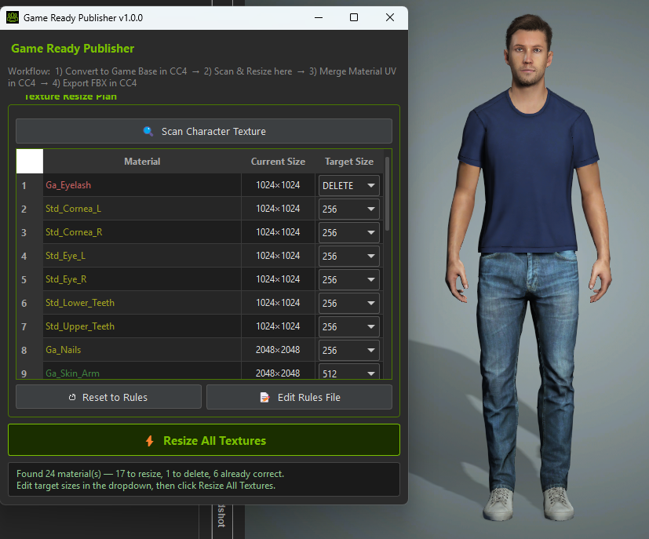
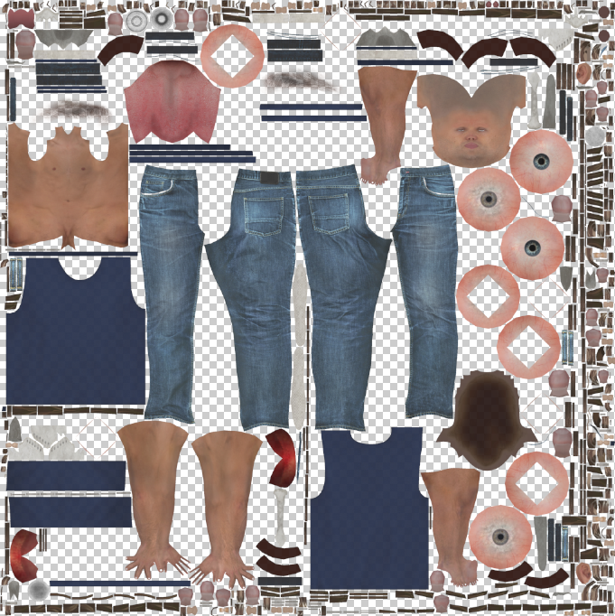
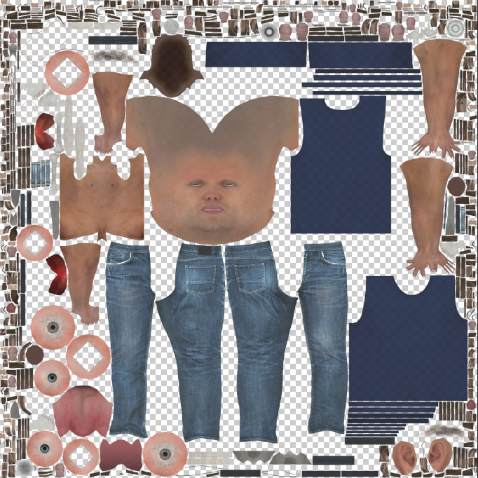

# Game Ready Publisher

A Character Creator 4 plugin that sizes each part of a character's textures for real-time use
before you bake the UV atlas.

When you run **Merge Material (UV)** in CC4, each material gets atlas space in proportion to
its texture size. If every part comes in at 4K, the face ends up sharing space evenly with
fingernails and shoes. This plugin resizes each material's texture by body part first, so the
face gets the detail and the small parts take up less of the atlas.

| Before (default sizes) | After (per-part sizes) |
|---|---|
|  |  |

The same character merged into one UV atlas. After resizing, the face gets far more of the
atlas, while hidden skin, nails and other small parts take less.

## What it does

- **Scans** the loaded character and lists every material's Diffuse texture with its current size.
- **Suggests a target size** for each one from keyword rules (head, body, arms, legs, eyes, teeth,
  nails, tongue, clothing, shoes). Eyelash and tearline textures are removed.
- **Lets you override** any target from a dropdown before anything changes.
- **Resizes everything in one click**, keeping colour profiles, then checks each new size.

Default rules:

| Part | Keywords | Size |
|---|---|---|
| Head / face | `skin_head`, `head` | 8192 |
| Body, arms, legs | `body`, `arm`, `leg` | 512 |
| Clothing | `pant`, `trouser`, `shirt`, `top`, `coat`, `jacket` | 2048 |
| Shoes | `shoe`, `boot`, `sneaker`, `sandal`, `loafer`, `slipper` | 512 |
| Eyes, teeth, nails | `eye`, `teeth`, `nail` | 256 |
| Tongue | `tongue` | 128 |
| Eyelashes, tearline | `eyelash`, `lash`, `tearline` | removed |
| Anything else | | 2048 |

Click **Edit Rules File…** in the plugin to change these. Your rules are saved in
`%APPDATA%\GameReadyPublisher\rules.json`.

## Workflow

1. In CC4, convert the character to a Game Base character and swap in game eyes and teeth if you use them.
2. Open **Plugins → Game Ready Publisher → Open** and click **Scan Character Textures**.
3. Adjust any sizes, then click **Resize All Textures**.
4. In CC4, run **Merge Material (UV)** and export your FBX as usual.

## Install

Download the latest zip from [Releases](https://github.com/DavidDoeppArt/GameReadyPublisher/releases), then see [INSTALL.md](INSTALL.md). In short: copy this folder into CC4's `Bin64\OpenPlugin` folder and make
sure Pillow is installed in CC4's Python.

## Notes and limits

- Built and tested on **Character Creator 4.0 for Windows**. CC5 is untested.
- Only the Diffuse channel is resized. In testing, resizing other channels through CC4's Python API
  failed or corrupted the texture, and the Diffuse size is what sets atlas space.
- Textures under 1024 px are skipped. CC4 uses small placeholder images for empty slots.

## Author

David Doepp · [github.com/DavidDoeppArt](https://github.com/DavidDoeppArt)
